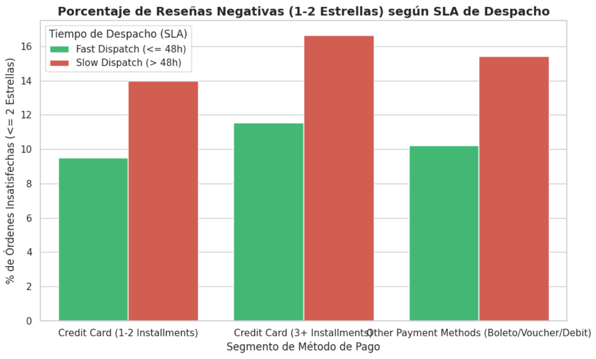
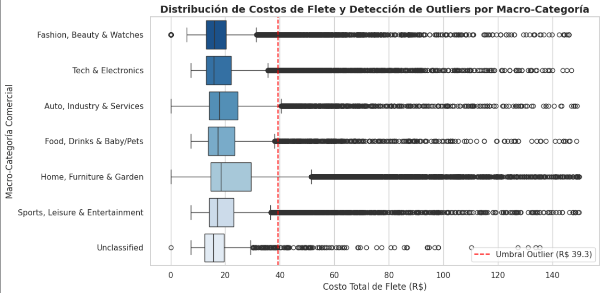

# Auditoría de Control de Gestión: Rentabilidad por Cuotas (AOV), SLA Logístico y Sobrecostos de Flete
**Caso de Estudio End-to-End: Brazilian E-Commerce Public Dataset by Olist (+95.000 Órdenes)**

**Autor:** Tomás Fuentes Ibañez — *Analista de Datos y Control de Gestión*  
**Stack Tecnológico:** Google Sheets / Excel | Google BigQuery (SQL) | Python (Pandas, Seaborn) | Power BI / Tableau *(En integración)*

---

## 1. Resumen Ejecutivo (Executive Summary)
Este proyecto ejecuta una auditoría integral de **Control de Gestión Comercial y Operativo** sobre una base relacional de **95.353 órdenes entregadas** en el marketplace Olist. Siguiendo el marco de análisis de datos de 6 fases de Google (*Ask, Prepare, Process, Analyze, Share, Act*), se evaluó cómo el financiamiento en cuotas impacta el ticket promedio (AOV) y cómo las demoras operativas de despacho afectan la satisfacción del cliente y los márgenes logísticos.

### Hallazgos Clave:
1. **Impacto Financiero de las Cuotas (+99,55% en AOV):** Los clientes que compran con tarjeta de crédito en **3 o más cuotas** representan el mayor volumen transaccional (36.733 órdenes) y registran un ticket promedio de **R$ 218,95**, casi duplicando el gasto de quienes pagan en 1-2 cuotas (**R$ 109,72**, +99,55%) y superando en **+53,87%** a otros medios de pago (**R$ 142,30**). Al aislar valores extremos mediante la mediana, el incremento real se mantiene en **+79,93%** (R$ 146,68 vs. R$ 81,52).
2. **Riesgo Operativo por Incumplimiento de SLA (>48h):** Superar las **48 horas** desde la aprobación del pago hasta la entrega al transportista (*Slow Dispatch > 48h*) provoca que la calificación promedio del segmento de alto valor (3+ cuotas) caiga de **4,22 a 3,99 estrellas**. La tasa de reseñas críticas (1 y 2 estrellas) se dispara del **11,54% al 16,66%** (+5,12 puntos porcentuales; un **aumento relativo del 44,37%** en insatisfacción), poniendo en riesgo la retención de 17.456 pedidos de alto margen.
3. **Auditoría de Sobrecostos Logísticos (Outliers):** Aplicando el método estadístico del Rango Intercuartílico (IQR), se determinó un techo presupuestario normal de flete de **R$ 39,27**. Se detectaron **9.569 órdenes (10,04% del total)** con sobrecostos atípicos de envío, concentradas principalmente en las macro-categorías *Home, Furniture & Garden*, *Auto, Industry & Services* y *Tech & Electronics*.

---

## 2. Arquitectura del Proyecto y Flujo de Trabajo

1. **Hojas de Cálculo (Google Sheets / Excel) — *Normalización de Catálogo*:**
   * Auditoría de la tabla maestra de categorías ([`dim_categories_cleaned.csv`](./dim_categories_cleaned.csv)).
   * Limpieza de cadenas de texto y corrección de errores tipográficos de origen mediante funciones anidadas (`PROPER`, `TRIM`, `SUBSTITUTE`).
   * Agrupación lógica de las **71 líneas de productos** en **6 Macro-Categorías Comerciales** utilizando condicionales avanzados (`IFS` + `REGEXMATCH`) para facilitar el control de márgenes por rubro.
2. **SQL (Google BigQuery) — *Modelado Relacional e Ingeniería de Variables*:**
   * Consolidación de **6 tablas relacionales** (`orders`, `items`, `payments`, `products`, `reviews` y `dim_categories`) evitando la multiplicación de filas (*fan-out*) mediante el uso modular de **CTEs (`WITH`)** y funciones de agregación.
   * Creación de reglas de negocio e indicadores de nivel de servicio (SLA) con `CASE WHEN` y cálculo preciso de tiempos de procesamiento mediante `DATETIME_DIFF` y `DATE_DIFF`.
   * Ver código completo en: [`olist_master_query.sql.txt`](./olist_master_query.sql.txt) | Dataset resultante: [`master_orders_analytics.csv`](./master_orders_analytics.csv)
3. **Python (Google Colab) — *Análisis Estadístico (EDA) y Detección de Outliers*:**
   * Procesamiento del dataset consolidado (95.353 registros) utilizando `pandas` y `numpy`.
   * Evaluación paramétrica (media) y no paramétrica (mediana) del ticket de compra, cuantificación de quejas mediante funciones `lambda`, y aislamiento matemático de sobrecostos de flete (`Q3 + 1.5 * IQR`).
   * Ver Notebook interactivo completo en: [`olist_statistical_eda.ipynb`](./olist_statistical_eda.ipynb)

---

## 3. Código SQL Destacado (BigQuery)

```sql
WITH 
-- 1. Pre-agregación financiera por orden para evitar duplicidad de pagos (Fan-out)
order_payments AS (
  SELECT 
    order_id,
    MAX(payment_type) AS primary_payment_type,
    MAX(payment_installments) AS max_installments,
    ROUND(SUM(payment_value), 2) AS total_payment_value
  FROM `olist_ecommerce.payments`
  GROUP BY order_id
),

-- 2. Cruce de ítems con catálogo de productos y macro-categorías normalizadas
order_items_cat AS (
  SELECT 
    i.order_id,
    COUNT(i.order_item_id) AS total_items,
    ROUND(SUM(i.price), 2) AS total_price,
    ROUND(SUM(i.freight_value), 2) AS total_freight,
    COALESCE(MAX(c.macro_category), 'Unclassified') AS macro_category,
    COALESCE(MAX(c.clean_category_english), 'Unclassified') AS category_english
  FROM `olist_ecommerce.items` AS i
  LEFT JOIN `olist_ecommerce.products` AS p ON i.product_id = p.product_id
  LEFT JOIN `olist_ecommerce.dim_categories` AS c ON p.product_category_name = c.product_category_name
  GROUP BY i.order_id
),

-- 3. Calificación promedio de satisfacción por orden
order_reviews AS (
  SELECT 
    order_id,
    ROUND(AVG(review_score), 1) AS avg_review_score
  FROM `olist_ecommerce.reviews`
  GROUP BY order_id
)

-- 4. Consulta Maestra: Cruce relacional y cálculo de KPIs logísticos y comerciales
SELECT 
  o.order_id,
  o.customer_id,
  o.order_status,
  DATE(o.order_purchase_timestamp) AS purchase_date,
  ic.macro_category,
  ic.category_english,
  ic.total_items,
  ic.total_price,
  ic.total_freight,
  p.primary_payment_type,
  p.max_installments,
  p.total_payment_value,
  CASE 
    WHEN p.primary_payment_type = 'credit_card' AND p.max_installments >= 3 THEN 'Credit Card (3+ Installments)'
    WHEN p.primary_payment_type = 'credit_card' AND p.max_installments < 3 THEN 'Credit Card (1-2 Installments)'
    ELSE 'Other Payment Methods (Boleto/Voucher/Debit)'
  END AS payment_segment,
  DATETIME_DIFF(o.order_delivered_carrier_date, o.order_approved_at, HOUR) AS hours_to_carrier,
  DATE_DIFF(DATE(o.order_delivered_customer_date), DATE(o.order_estimated_delivery_date), DAY) AS delivery_delay_days,
  CASE 
    WHEN DATETIME_DIFF(o.order_delivered_carrier_date, o.order_approved_at, HOUR) <= 48 THEN 'Fast Dispatch (<= 48h)'
    ELSE 'Slow Dispatch (> 48h)'
  END AS dispatch_sla_status,
  r.avg_review_score
FROM `olist_ecommerce.orders` AS o
INNER JOIN order_items_cat AS ic ON o.order_id = ic.order_id
INNER JOIN order_payments AS p ON o.order_id = p.order_id
LEFT JOIN order_reviews AS r ON o.order_id = r.order_id
WHERE o.order_status = 'delivered'
  AND o.order_approved_at IS NOT NULL
  AND o.order_delivered_carrier_date IS NOT NULL
  AND DATETIME_DIFF(o.order_delivered_carrier_date, o.order_approved_at, HOUR) >= 0;
```

---

## 4. Resultados Estadísticos y Visualizaciones (Python)

### A. Rendimiento Financiero por Segmento de Pago (AOV)

| Segmento de Método de Pago | Total Órdenes | Ticket Promedio (Media) | Ticket Mediano (Mediana) | Review Score Promedio |
| :--- | :---: | :---: | :---: | :---: |
| **Credit Card (3+ Installments)** | 36.733 | **R$ 218,95** | **R$ 146,68** | 4,11 |
| **Other Payment Methods (Boleto/Voucher/Debit)** | 24.004 | R$ 142,30 | R$ 92,57 | 4,15 |
| **Credit Card (1-2 Installments)** | 34.616 | R$ 109,72 | R$ 81,52 | 4,20 |

### B. Impacto del SLA de Despacho (48 Horas) en la Satisfacción del Cliente

| Segmento de Método de Pago | Estado SLA Despacho | Volumen de Órdenes | Review Promedio | % Reseñas Negativas (1-2 ★) |
| :--- | :---: | :---: | :---: | :---: |
| **Credit Card (1-2 Installments)** | Fast Dispatch (<= 48h) | 18.954 | 4,31 | 9,51% |
| **Credit Card (1-2 Installments)** | Slow Dispatch (> 48h) | 15.662 | 4,08 | 13,98% |
| **Credit Card (3+ Installments)** | Fast Dispatch (<= 48h) | 19.277 | **4,22** | **11,54%** |
| **Credit Card (3+ Installments)** | Slow Dispatch (> 48h) | 17.456 | **3,99** | **16,66%** |
| **Other Payment Methods** | Fast Dispatch (<= 48h) | 13.451 | 4,25 | 10,22% |
| **Other Payment Methods** | Slow Dispatch (> 48h) | 10.553 | 4,03 | 15,41% |



### C. Control de Costos Logísticos: Detección de Outliers en Fletes (Método IQR)
* **Umbral Superior Estadístico (Q3 + 1.5 * IQR):** `R$ 39,27`
* **Órdenes con Sobrecosto Detectadas:** `9.569 órdenes` (`10,04%` del volumen total auditado).



---

## 5. Recomendaciones Estratégicas de Control de Gestión

1. **Priorización Operativa (Fast-Track SLA) para Pedidos de Alto Valor:** Implementar una alerta automatizada en el sistema de gestión de bodegas/vendedores que priorice el despacho dentro de las primeras **24 a 36 horas** para toda orden pagada en 3+ cuotas o superior a R$ 150, protegiendo el segmento que aporta casi el doble de ingresos por transacción.
2. **Auditoría de Tarifas de Flete en Rubros Críticos:** Revisar los contratos de transporte y dimensionamiento de paquetes en las categorías *Home, Furniture & Garden* y *Auto, Industry & Services*, estableciendo un control preventivo de margen cuando el ratio `freight_to_price_ratio` supere el 25% del valor del producto o el umbral de R$ 39,27.
3. **Incentivos Comerciales Basados en Cumplimiento Logístico:** Condicionar la visibilidad destacada de los vendedores (*Sellers*) dentro del marketplace a mantener una tasa de cumplimiento de despacho (`<= 48h`) superior al 85%.
